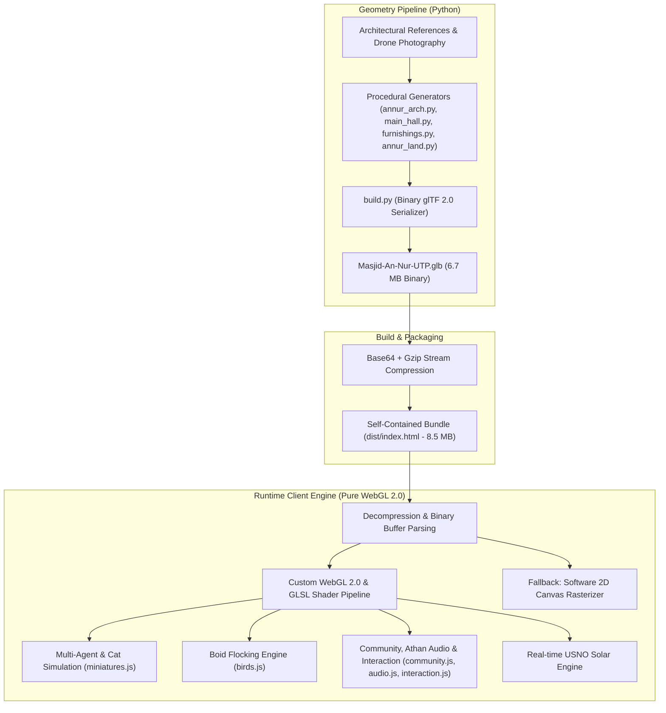

# Technical Architecture & Engineering Reference

This document details the procedural geometry pipeline, custom binary glTF 2.0 serializer, WebGL 2.0 rendering engine, astronomical lighting model, and multi-agent simulation systems powering **Masjid An-Nur UTP**.

> Return to the main project overview: **[README.md](README.md)**

---

## 🏗️ System Pipeline

---

## 📊 Technical Specifications

| Parameter | Specification |
| :--- | :--- |
| **Model Format** | Standard glTF 2.0 Binary (`.glb`) |
| **Model Binary Size** | 6.7 MB (`6,977,436` bytes — `Masjid-An-Nur-UTP.glb`) |
| **Offline Viewer Bundle** | 8.5 MB self-contained (`index.html`) |
| **Rendering API** | WebGL 2.0 / GLSL (with 2D Canvas software fallback) |
| **External Dependencies** | 0 (Pure Vanilla JavaScript, Python Standard Library, & native Web APIs) |
| **Target Frame Rate** | 60 FPS on modern desktop & mobile browsers |
| **Coordinate System** | Right-handed Y-up (meters) |
| **PBR Materials** | Metallic-roughness workflow with custom alpha blending |
| **PWA Support** | Installable web app (`manifest.webmanifest` + `app-icon.png`) |
| **Hosting Platform** | Netlify Edge CDN |

---

## 🔬 Engineering Modules

### 1. Visual Reference & Spatial Alignment
All geometry is modeled directly from photographic and spatial observations of the UTP campus:
* **Overhead & Satellite Perspectives**: High-angle drone imagery ([image/mosque-aerial-dome-top-down.png](image/mosque-aerial-dome-top-down.png)) and satellite captures ([image/mosque-satellite-overhead-view.png](image/mosque-satellite-overhead-view.png)) established the modular grid spacing (5.08 m × 4.88 m arcade bays) and stepped shoreline perimeter.
* **Structural Elevations**: On-site reference photography ([image/prayer-hall-mihrab-wall-elevation.png](image/prayer-hall-mihrab-wall-elevation.png), [image/prayer-hall-dome-calligraphy-zenith.png](image/prayer-hall-dome-calligraphy-zenith.png), and [image/mosque-lakeside-dusk-reflections.png](image/mosque-lakeside-dusk-reflections.png)) defined column heights, window mullion divisions, mezzanine railings, and the 60-mullion circular drum.
* **PBR Material Sampling**: Authentic photographs of the marble mihrab wall ([image/mihrab-marble-wall-detail.jpeg](image/mihrab-marble-wall-detail.jpeg)), calligraphy bands, teakwood, and RMUTP signage are packed directly into the binary as JPEG textures.

### 2. Procedural Geometry Generation (`annur-viewer/source/`)
The architecture and furnishings are constructed mathematically in Python:
* **Spherical Rhombic Dome (`annur_arch.py`)**:
  The upper dome surface is discretized into 11 concentric rows of 36 rhombic diamond courses. Each vertex coordinate is computed parametrically:
  $$\phi = \frac{j}{\text{rows}} \cdot \frac{\pi}{2}, \quad r = R \cos\phi$$
  $$\mathbf{P}(i, j) = \left(r \cos\left(\frac{\pi i}{n}\right), \, y_0 + h \sin\phi, \, z_0 + r \sin\left(\frac{\pi i}{n}\right)\right)$$
  Individual diamond panels undergo polygon insetting towards their centroid to form standing seams with subtle procedural patina variations.
* **Mathematical Lathe Extrusions**:
  Columns, arcade lanterns, drum mouldings, and tiered finials are generated via angular revolution matrices around world-space origins with analytical normal vectors:
  $$\mathbf{n} = \frac{\mathbf{u} \times \mathbf{v}}{\|\mathbf{u} \times \mathbf{v}\|}$$
* **Interior & Furnishings (`main_hall.py`, `furnishings.py`)**:
  Generates the double-height prayer hall, upper Muslimat mezzanine with geometric lattice screens and *rak telekung*, *Bilik Imam* & *Bilik Khatib*, carved minbar, separate male/female wudu wash bays, entrance noticeboard, *Tabung Masjid* donation boxes, and the contributor plaque.
* **Low-Poly Landscape (`annur_land.py`)**:
  Procedural terrain displacement using composite sine/cosine waves, lake basin geometry, causeway ramp, parked campus motorbikes/scooters, and instanced palm trees.

### 3. Custom glTF 2.0 Binary Serializer (`build.py`)
`build.py` implements a zero-dependency glTF 2.0 binary (`.glb`) packer using Python's native `struct` module:
* **Binary Alignment & Padding**: Generates 4-byte aligned JSON metadata (`CHUNK_TYPE = 0x4E4F534A`) and binary payload chunks (`CHUNK_TYPE = 0x004E4942`).
* **Interleaved Vertex Buffers**: Packs 28-byte stride vertex records containing `POSITION` (`VEC3` float32), `NORMAL` (`VEC3` float32), and `COLOR_0` (`VEC4` normalized uint8), plus optional 8-byte `TEXCOORD_0` UV coordinates.
* **Vertex Deduplication**: Builds indexed triangle meshes on the fly to optimize GPU cache locality and preserve sharp architectural creases.

### 4. Custom WebGL 2.0 & GLSL Shader Pipeline (`viewer.js`)
* **Zero External 3D Libraries**: Communicates directly with the native WebGL 2.0 context without Three.js or Babylon.js.
* **Dual-Mode Rendering Engine**:
  * **Hardware Mode**: WebGL 2.0 pipeline with custom vertex/fragment shaders for Blinn-Phong/PBR lighting, Fresnel water reflection with animated harmonic ripples, and depth sorting.
  * **Software Mode**: Pure 2D Canvas rasterizer fallback for environments without WebGL support.
* **Single-File Offline Bundle**: Compresses the glTF binary, embedded textures, DuitNow QR, Athan MP3 audio, and scripts into inline Gzip base64 streams inside `dist/index.html`.

### 5. Astronomical Solar Algorithm
Sun position is computed dynamically from the exact coordinates of Masjid An-Nur UTP:
* **Coordinates**: $4.38587^\circ\text{ N}, \, 100.97396^\circ\text{ E}$ (Seri Iskandar, Perak, Malaysia).
* Computes days since epoch J2000.0, solar mean anomaly, ecliptic longitude, and solar elevation angle $h$ in Malaysia Time (MYT), dynamically blending sky zenith, horizon color, ambient light, and water reflections.

### 6. Multi-Agent Simulation, Audio & Interaction (`miniatures.js`, `birds.js`, `community.js`, `interaction.js`, `audio.js`)
* **Worshipper & Campus FSMs (`miniatures.js`)**: Autonomous Finite State Machines for visitors walking, washing at wudu stations, reading Qur'an in *Halaqah* circles, Friday Khutbah congregation, Thursday *Blessings Over Meals (BOM)* communal dining, UTP students with backpacks, children playing on the lawn, and the roaming mosque cat (*Si Kucing Masjid*).
* **Craig Reynolds' Flocking (`birds.js`)**: Lake birds fly along Bézier trajectories with separation, alignment, and cohesion steering forces before perching on rooflines.
* **Interactive Community & Audio (`community.js`, `interaction.js`, `audio.js`)**: Proximity prompts and raycast/click handlers for *Tabung Masjid* DuitNow QR donations, RM1 koi fish feeding, petting the mosque cat, JAKIM Perak Zone 2 live prayer times, Ayah Explainer (Surah An-Nur 24:35 & Ayat al-Kursi), guided history tour, and spatial/ambient Athan playback.
