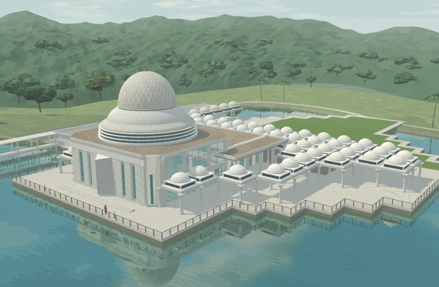
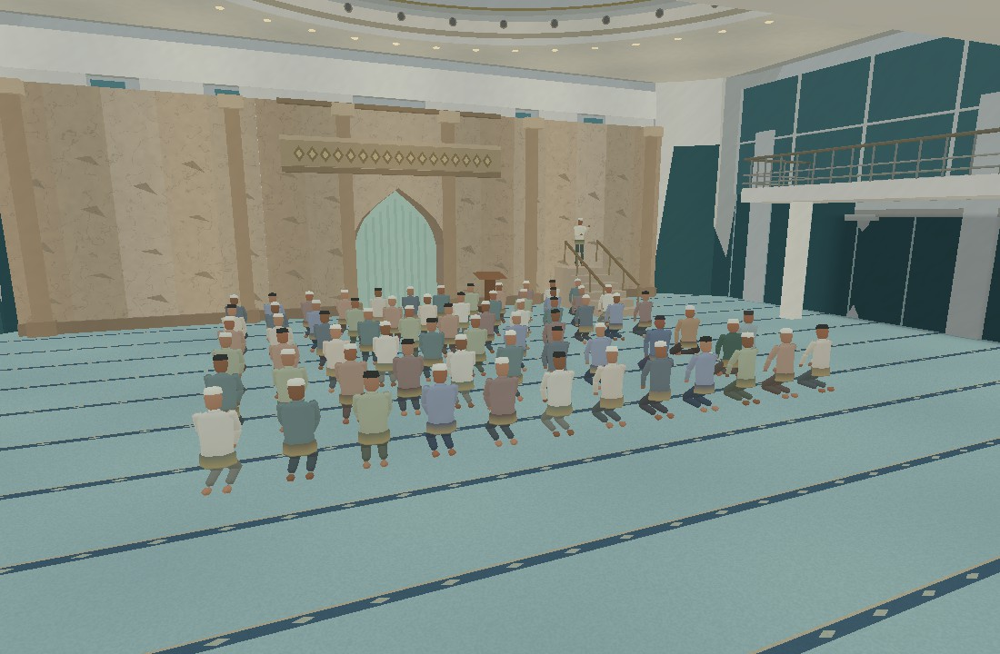

# Masjid An-Nur UTP · Interactive 3D Visualizer & Architectural Study

[](https://masjid-annur-utp.netlify.app)
[](https://app.netlify.com/sites/masjid-annur-utp/deploys)
[](https://github.com/Aidirrr/masjid-annur-utp)
[](https://www.khronos.org/webgl/)
[-orange?style=flat)](https://www.khronos.org/gltf/)
[-success?style=flat)]()

> 🌐 **Live Web Application**: **[https://masjid-annur-utp.netlify.app](https://masjid-annur-utp.netlify.app)**

An interactive, self-contained 3D architectural recreation and living simulation of **Masjid An-Nur** at Universiti Teknologi PETRONAS (UTP) in Seri Iskandar, Perak, Malaysia.

Engineered with procedural Python geometry generation and a custom zero-dependency WebGL 2.0 rendering engine, the application runs entirely client-side and offline, simulating architectural lighting, water reflections, astronomical sun positioning, and autonomous multi-agent congregational behavior.

---

## 🎬 3D Model Showcase & Tour



> 📹 *A 60fps high-definition MP4 video tour is also included in the repository: [image/masjid-an-nur-tour.mp4](image/masjid-an-nur-tour.mp4)*.

---

## ✨ Features & Visual Highlights


### 🏛️ Architectural Recreation
* **Parametric Grand Dome**: Mathematical ribbed dome featuring diamond-lattice rhombic tiling courses, standing seams, elevated drum clerestory with sunshades, and a tiered brass finial.
* **Colonnaded Arcades & Stepped Cupolas**: A grid of flared classical columns supporting stepped canopy roofs topped with roof lanterns and miniature cupolas, extending directly over the water.
* **Interior Main Prayer Hall**: Double-height prayer space containing an authentic marble mihrab wall, minbar staircase, Qur'anic calligraphy drum frieze, second-story mezzanine balustrades, and oriented prayer carpet rows.
* **Aquatic Setting & Low-Poly Terrain**: Realistic water surface with real-time planar reflections, stepped lakeside promenade, entrance causeway, and surrounding tropical topography.

### 👥 Living Multi-Agent Simulation
* **Jumu’ah (Friday Prayer) Sequence**: A fully synchronized 100-second congregation sequence featuring worshippers arriving over the causeway, performing ablution at wudu stations, and gathering in rows behind the imam delivering the khutbah.
* **Autonomous Worshipper States**: Dynamic Finite State Machines (FSMs) controlling visitors walking, performing wudu sequences, participating in Qur'anic reading circles (**Halaqah**), and executing prayer postures (*qiyam*, *ruku'*, *sujud*, *jalsah*).
* **Interactive Fish Feeding**: Real-time koi fish school simulation in the lake. Press **`F`** or click **Feed fish** on the terrace to toss breadcrumbs and draw fish to the surface.
* **Flocking Mosque Birds**: Autonomous 3D boid flight simulation with aerodynamic wing chord kinematics soaring over the lake and returning to roofline perches.

### ☀️ Astronomical Solar Lighting
* **Live Sun Calculation for Seri Iskandar**: Real-time solar azimuth and elevation calculated from geographic coordinates (**4.3858° N, 100.9739° E**) using USNO astronomical algorithms in Malaysia Time (MYT).
* **Atmospheric Presets**: Configurable lighting conditions including Daytime, Sunrise, Golden Sunset, Morning, and an Illuminated Night mode with soft lanterns and reflective water highlights.

### 🚶 Exploration & Navigation
* **Free Orbit Camera**: Smooth 360° orbit controls with pinch/scroll zoom, momentum, and 12 preset camera viewpoints.
* **First-Person Walkthrough**: Ground-clamped walking tour using **`W` / `A` / `S` / `D`** with sprint kinematic multiplier (**`Shift`**) and mouse-look orientation.



---

## 🏗️ Technical Architecture & Pipeline

```mermaid
flowchart TD
    subgraph Geometry Pipeline (Python)
        A["Architectural References & Drone Photography"] --> B["Procedural Generators (annur_arch.py, main_hall.py, annur_land.py)"]
        B --> C["build.py (Binary glTF 2.0 Serializer)"]
        C --> D["Masjid-An-Nur-UTP.glb (5.3 MB Binary)"]
    end

    subgraph Build & Packaging
        D --> E["Base64 + Gzip Stream Compression"]
        E --> F["Self-Contained Bundle (dist/index.html - 6.7 MB)"]
    end

    subgraph Runtime Client Engine (Pure WebGL 2.0)
        F --> G["Decompression & Binary Buffer Parsing"]
        G --> H["Custom WebGL 2.0 & GLSL Shader Pipeline"]
        G --> I["Fallback: Software 2D Canvas Rasterizer"]
        H --> J["Multi-Agent AI Simulation (miniatures.js)"]
        H --> K["Boid Flocking Engine (birds.js)"]
        H --> L["Real-time USNO Solar Engine"]
    end
```

---

## 🔬 In-Depth Engineering & Technical Details

### 1. Visual Reference & Screenshot Alignment
Rather than relying on generic building templates, all geometry was reverse-engineered directly from photographic and spatial observations:
* **Overhead & Satellite Perspectives**: High-angle drone imagery ([image/mosque-aerial-dome-top-down.png](image/mosque-aerial-dome-top-down.png)) and satellite captures ([image/mosque-satellite-overhead-view.png](image/mosque-satellite-overhead-view.png)) established the exact modular grid spacing (5.08 m × 4.88 m arcade bays) and stepped shoreline perimeter.
* **Structural Elevations**: On-site reference photography ([image/prayer-hall-mihrab-wall-elevation.png](image/prayer-hall-mihrab-wall-elevation.png), [image/prayer-hall-dome-calligraphy-zenith.png](image/prayer-hall-dome-calligraphy-zenith.png), and [image/mosque-lakeside-dusk-reflections.png](image/mosque-lakeside-dusk-reflections.png)) defined column heights, window mullion divisions, mezzanine railings, and the 60-mullion circular drum.
* **PBR Material Sampling**: Authentic photographs of the marble mihrab wall ([image/mihrab-marble-wall-detail.jpeg](image/mihrab-marble-wall-detail.jpeg)) and calligraphic bands were processed into seamless texture maps.

### 2. Procedural Geometry Generation (`annur-viewer/source/`)
The architecture is constructed entirely through clean mathematical algorithms in Python:
* **Spherical Rhombic Dome Formulation (`annur_arch.py`)**:
  The upper dome surface is discretized into 11 concentric rows of 36 rhombic diamond courses. Each vertex coordinate is computed parametrically:
  $$\phi = \frac{j}{\text{rows}} \cdot \frac{\pi}{2}, \quad r = R \cos\phi$$
  $$\mathbf{P}(i, j) = \left(r \cos\left(\frac{\pi i}{n}\right), \, y_0 + h \sin\phi, \, z_0 + r \sin\left(\frac{\pi i}{n}\right)\right)$$
  Individual diamond panels undergo polygon insetting towards their centroid to form standing seams and are assigned subtle procedural patina variations.
* **Mathematical Lathe Extrusions**:
  Columns, arcade lanterns, drum mouldings, and tiered finials are generated via angular revolution matrices around specific world-space origin coordinates with normal vector calculation:
  $$\mathbf{n} = \frac{\mathbf{u} \times \mathbf{v}}{\|\mathbf{u} \times \mathbf{v}\|}$$
* **Low-Poly Landscape Synthesis (`annur_land.py`)**:
  Procedural terrain displacement using composite sine/cosine trigonometric waves, water basin geometry, causeway approach ramp, and instanced palm trees with logarithmic stem curvature.

### 3. Custom glTF 2.0 Binary Serializer (`build.py`)
Instead of using heavy 3D authoring suites, `build.py` implements a zero-dependency glTF 2.0 binary (`.glb`) packer using Python's native `struct` module:
* **Binary Alignment & Padding**: Generates structured 4-byte aligned JSON metadata (`CHUNK_TYPE = 0x4E4F534A`) and binary payload chunks (`CHUNK_TYPE = 0x004E4942`).
* **Interleaved Vertex Buffers**: Packs 28-byte stride vertex records containing `POSITION` (`VEC3` float32), `NORMAL` (`VEC3` float32), and `COLOR_0` (`VEC4` normalized uint8), with optional 8-byte `TEXCOORD_0` UV coordinate accessors.
* **Vertex Deduplication**: Computes indexed triangle meshes on-the-fly to optimize GPU cache locality and preserve sharp architectural creases.

### 4. Custom WebGL 2.0 & GLSL Shader Pipeline (`viewer.js`)
* **Zero External 3D Libraries**: No Three.js, Babylon.js, or external runtime frameworks. The visualizer communicates directly with native WebGL 2.0 context.
* **Dual-Mode Rendering Engine**:
  * **Hardware Mode**: WebGL 2.0 pipeline utilizing customized vertex and fragment shaders for Blinn-Phong/PBR lighting, Fresnel water reflection with animated harmonic ripples, and depth sorting.
  * **Software Mode**: A pure 2D Canvas rasterizer fallback for older mobile devices or environments where WebGL is unsupported.
* **Single-File Zero-Dependency Bundle**: Compresses the 3D model, textures, audio-visual assets, and scripts into inline Gzip base64 octet streams, allowing the entire application to run offline from a standalone HTML file.

### 5. Astronomical Solar Algorithm
The sun position is calculated dynamically based on the exact latitude and longitude of the site:
* **Coordinates**: $4.38587^\circ\text{ N}, \, 100.97396^\circ\text{ E}$ (Perak, Malaysia).
* Computes days since epoch J2000.0, solar mean anomaly, ecliptic longitude, and solar elevation angle $h$.
* Dynamically blends sky zenith, horizon color, cloud scatter, ambient light coefficient, and water coloration across a continuous time continuum.

### 6. Autonomous Multi-Agent Behaviors (`miniatures.js`, `birds.js`)
* **Worshipper FSMs**: Autonomous agents navigate using vector waypoints. Dynamic states transition smoothly through walking, washing at wudu stations, sitting in halaqah circles, and synchronized congregation postures.
* **Craig Reynolds' Flocking Simulation**: Lake birds fly along mathematical Bézier trajectories, adjusting velocity through separation, alignment, and cohesion steering forces before perching on the parapets.

---

## 📊 Technical Specifications

| Parameter | Specification |
| :--- | :--- |
| **Model Format** | Standard glTF 2.0 Binary (`.glb`) |
| **Model Binary Size** | 5.3 MB (`Masjid-An-Nur-UTP.glb`) |
| **Offline Viewer Bundle** | 6.7 MB self-contained (`index.html`) |
| **Rendering API** | WebGL 2.0 / GLSL (with 2D Canvas fallback) |
| **External Dependencies** | 0 (Pure Vanilla JavaScript & native Web APIs) |
| **Target Frame Rate** | 60 FPS on modern desktop & mobile browsers |
| **Coordinate System** | Right-handed Y-up (meters) |
| **PBR Materials** | Metallic-roughness workflow with custom alpha blending |
| **Hosting Platform** | Netlify Edge CDN (Continuous Deployment) |

---

## 🚀 How to Run the Visualizer

### Option 1: Live Web Application (Netlify)
Launch the 3D visualizer instantly in any browser:
* **[https://masjid-annur-utp.netlify.app](https://masjid-annur-utp.netlify.app)**

#### Direct URL Preset API:
The viewer supports dynamic URL query parameters to jump directly to specific camera angles, scenes, and lighting:

| Viewpoint | Live URL Link |
| :--- | :--- |
| **Daytime Lakeside** | [https://masjid-annur-utp.netlify.app/?light=day&view=lake](https://masjid-annur-utp.netlify.app/?light=day&view=lake) |
| **Main Prayer Hall** | [https://masjid-annur-utp.netlify.app/?light=day&view=hall](https://masjid-annur-utp.netlify.app/?light=day&view=hall) |
| **Friday Khutbah** | [https://masjid-annur-utp.netlify.app/?light=day&scene=friday&phase=2&view=gathering](https://masjid-annur-utp.netlify.app/?light=day&scene=friday&phase=2&view=gathering) |
| **Sunset on the Lake** | [https://masjid-annur-utp.netlify.app/?light=sunset&view=lake](https://masjid-annur-utp.netlify.app/?light=sunset&view=lake) |
| **Live Seri Iskandar Sun** | [https://masjid-annur-utp.netlify.app/?light=live](https://masjid-annur-utp.netlify.app/?light=live) |
| **Clean Capture (No UI)** | [https://masjid-annur-utp.netlify.app/?clean=1&light=day&view=lake](https://masjid-annur-utp.netlify.app/?clean=1&light=day&view=lake) |

### Option 2: Standalone Offline File (No Server Needed)
Simply open the built HTML file in Google Chrome or any modern browser:
* [annur-viewer/dist/index.html](annur-viewer/dist/index.html)

### Option 3: Local Development Server
To serve locally from the repository root:
```bash
python3 -m http.server 8080 --directory annur-viewer/dist
```
Then navigate to **[http://localhost:8080](http://localhost:8080)**.

### Option 4: External 3D Software
The generated [Masjid-An-Nur-UTP.glb](annur-viewer/dist/Masjid-An-Nur-UTP.glb) (5.3 MB) file is standard glTF 2.0 and can be imported directly into:
* **Blender** (`File > Import > glTF 2.0`)
* **Unity / Unreal Engine / Godot**
* **macOS Quick Look** (select file in Finder and tap `Space`)

---

## 🛠️ Build & Development Workflow

To modify the procedural geometry, shaders, or simulation logic:

### Prerequisites:
* Python 3.10+ (Standard library only; no pip dependencies required)
* Any modern web browser supporting WebGL 2.0

### Build Instructions:
1. Navigate to the source directory:
   ```bash
   cd annur-viewer/source
   ```
2. Run the procedural compiler:
   ```bash
   python3 build.py
   ```
   *Compiles 3D geometry into `dist/Masjid-An-Nur-UTP.glb` and packages the compressed offline viewer at `dist/index.html`.*

---

## 🤝 Community Contributions & Roadmap

Contributions, suggestions, and improvements are very welcome! Here are potential areas for further technical enhancement:

* **Interior Detail Expansion**: Adding chandeliers, acoustic wood panels, ceiling fans, and detailed wudu water tap fittings.
* **Audio Engineering**: Spatial 3D Web Audio for water ripples, lake breeze, prayer call (*adhan*), and reverberant recitation.
* **WebXR Immersive Walkthrough**: Adding VR/AR headset support for virtual tours inside the prayer hall.
* **Foliage & Botanical Variety**: Expanding the procedural vegetation system with varied tropical trees, reeds, and water lilies.
* **Performance Profiling**: Level of Detail (LOD) geometry mesh decimation for lower-end mobile devices.

### How to Contribute:
1. **Fork** the repository on GitHub.
2. Clone your fork locally:
   ```bash
   git clone https://github.com/<your-username>/masjid-annur-utp.git
   cd masjid-annur-utp
   ```
3. Create a feature branch (`git checkout -b feature/amazing-feature`).
4. Edit the procedural Python generators or viewer scripts.
5. Recompile with `python3 annur-viewer/source/build.py`.
6. Commit your changes and open a **Pull Request**.

---

## 📜 Acknowledgements & Attribution
Architectural study and visualizer developed for **Masjid An-Nur, Universiti Teknologi PETRONAS**.
Reference photography and observational documentation courtesy of community contributors.
