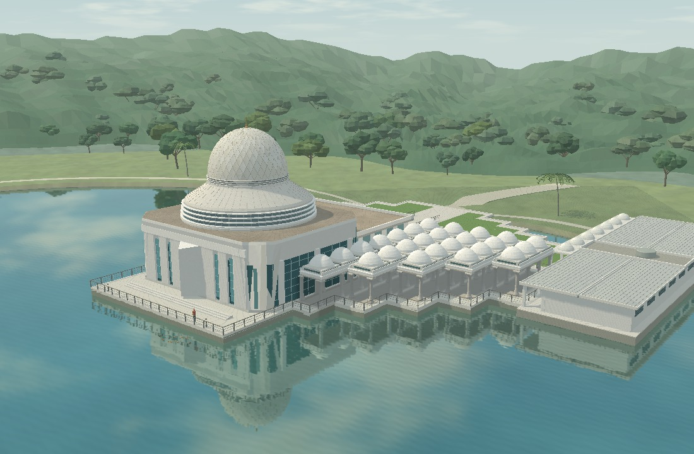

# Masjid An-Nur UTP

## Interactive 3D visualizer

Explore Masjid An-Nur at Universiti Teknologi PETRONAS from the lake, step inside the domed prayer hall, or watch the miniature visitors feeding fish by the terrace. The model follows reference photographs and drawings of the ground plaza and mezzanine. Its dimensions are approximate.

After cloning or downloading the repository, open [the self-contained viewer](annur-viewer/dist/index.html) in Chrome. It works offline. Drag to orbit, scroll or pinch to zoom, and use **Viewpoint** to choose **Inside mosque**, **Prayer close-up**, or **Fish feeding**. Toggle **Auto-rotate** to pause or resume the three-minute orbit.

**First person** starts a walking tour. Use W/A/S/D or the movement buttons to walk, drag to look around, and choose a viewpoint to jump to the mosque interior, the Qur’an reading circle (**Halaqah**), the **Wudu area**, or the fish-feeding terrace. Press Escape to return to orbit.

Hold **Shift** while walking or enable **Sprint** on the movement pad to cover ground faster. **Feed fish** (or **F** with the viewer focused) takes you to the terrace to toss food. Visitors wash at the wudu stations, and birds fly over the lake and perch on the roof.

Choose **Jumu’ah · Friday prayer** under **Scene** for a 100-second sequence. Watch worshippers arrive across the causeway and through the east entrance, visit the wudu stations, then follow the imam from the minbar to the front of the prayer rows. Use **Phase** to jump to the khutbah or prayer, or explore in first person.

**Live** lighting follows the calculated sun position in Seri Iskandar and displays Malaysia Time. Five manual presets cover daytime, night, morning, sunrise and sunset. Cloud cover is simulated.

The [GLB model](annur-viewer/dist/Masjid-An-Nur-UTP.glb) contains the architecture for use in other 3D tools. The browser viewer adds the animated people, fish, water and lighting.
